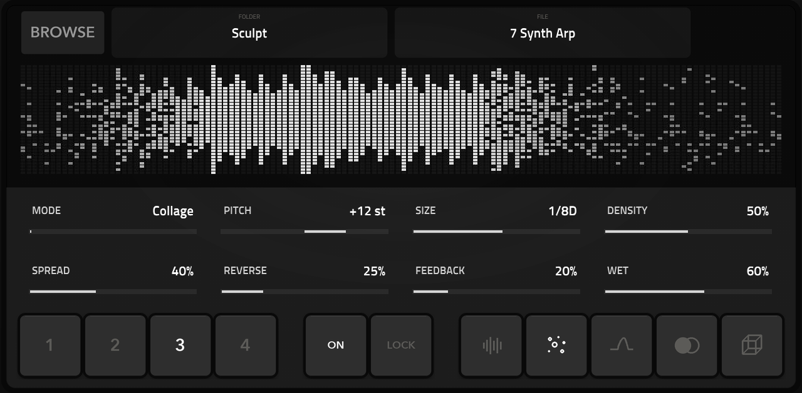

# Sculpt

A four-track loop-shaping instrument for Akai MPC standalone hardware, by Lightlike.

Each of the four tracks plays a loop through five modules in a row:

```
SOURCE  ->  GRAIN  ->  FILTER  ->  COLOR  ->  SPACE
```

Each module has its own screen, eight knobs and an on/off switch. Each screen has one large
picture that changes as you turn those knobs.



## Playing it

- **Pads and keys play the picked track** (track keys 1–4 on the screen). Pad 1 of whichever pad
  bank is showing plays the loop at its recorded pitch, and the 16 pads go up a semitone each.
  Every bank plays the same, so the MPC's bank never matters (a keyboard repeats every 16 notes).
- **MIDI channels 2–5 always play tracks 1–4**, so a sequence can play each track on its own
  channel. Channel 1 (and 6–16) plays the picked track.
- **To loop a track in time without holding a pad,** turn on **SYNC** (on the Source page, with the track picked)
  and press Play on the MPC. The track runs with the transport, locked to the beat.
- Pitch bend is ±2 semitones on every track.
- With **Loop** set to Off, a note plays its region once and ignores note-off (one-shot). In
  Fwd and Ping a track plays while the note is held, and fades out over **Fade** when it ends.

## The screen

The function keys under the screen are **SCULPT** and **MIX**. SCULPT shows one module page at a
time for the picked track. The row of keys along the bottom:

- **Track keys 1–4** (left): pick the track. Everything on screen follows it: the cells, the
  Q-Links, the pictures, the browser and the pads.
- **ON / OFF** (middle): turns the page's module on or off for the picked track.
- **SYNC / LOCK / FREEZE** (next to it): the page's own toggle: Sync on Source, Lock on Grain,
  Freeze on Space. Filter and Color have none.
- **Module keys** (right, five): pick the page: Source, Grain, Filter, Color or Space. The lit key
  is the page you're on.

Above them:

- **Cells**: the page's settings. Drag a cell, or touch it and turn the Q-Links. Double-tap a
  cell for the big knob.
- **Q-Links**: 12 knobs that follow the page on screen: cells 1–4, 5–8 and 9–12 (on Space, the
  Chorus, Delay and Reverb columns). On Source, knobs 9 and 10 browse folders and files.
- **Pictures**: the picked track's waveform, Grain pixels, Filter spectrum, playhead and loop
  markers. They move while their page is on screen.
- **BROWSE** opens the list for the picked track.

To automate a track, use its own parameters (`T1 Cutoff`, `T2 Drive` and so on). The knob
parameters (`T1 Knob 1`...) follow whatever page and track are showing, so they are not for
automation.

## Mixing

The second function key opens **MIX**: one strip per track and a master strip.

- **Meter and fader:** each strip has a level meter and a volume fader on the same dB scale
  (+6 to −60). 0 dB sits at the same height on both, and the fader's bottom is silent (−inf).
  The meter shows the track after its fader, pan and mute. The master meter shows Sculpt's
  output.
- **Pan** places the track left or right (L100 … C … R100).
- **Mute** silences a track. **Solo** plays only the soloed tracks (you can solo several).
- **Q-Links on MIX:** the first bank controls the four volumes, the second the four pans, and
  the third the master volume. Touch a fader or a pan to bank the knobs to it, and double-tap
  one for the big knob.

The mix sits after Space, so **Level** on the Source page stays a separate gain into each
track's effects. In the Program Q-Links, knobs 1–4 are now the four track volumes.

## Parameters (per track)

| Module | Parameters |
| --- | --- |
| **Source** | **Speed** (−2× … +2×, below zero plays backwards), **Rotate** (turns the loop: where in it playback begins; it wraps round inside the loop, like turning a tape loop to move its downbeat; a pink dashed line marks it), **Start** (where the loop begins in the sample: the left cyan line), **Length** (how long the loop is, from Start; it stops at the end of the sample: the right cyan line. Outside the two lines the waveform is dimmed), **Pitch** (±24 st: changes the note but not the timing, so the loop keeps its length and stays in time; it works with Sync too. Speed is the tape-style control, where faster is also higher), **Level**, **Fade** (1 ms – 2 s: how long the loop's end crossfades into its start each time it goes round, and the fade-in and release of each note), **Loop** (Off / Fwd / Ping). **Root** (the note that plays the loop at its own pitch) is fixed at C0, pad A01 in the MPC's usual layout. The sound itself comes from the browser row above the waveform. Toggle **Sync**: the track loops by itself while the MPC is playing, locked to its tempo and beat, and fades out when you stop. No pad needed. The region is fitted to a whole number of beats (its length at 120 BPM rounded to 1, 2, 4 … 64 beats, so a built-in loop is 8), **Speed** plays it ×2, ×½ and so on, still in time, and a negative Speed plays it backwards. |
| **Grain** | The picture is the sample's waveform (as on Source) drawn in pixels: solid where the grains are picking from right now (following the sample as it plays), with the pixels dissolving away at random the further you go to either side. With Grain off the whole waveform shows. The engine comes from Lightlike's Grainbloom: the track's sound is recorded (about 6 s) and grains are picked from it in one of seven **Mode**s: **Collage** (tempo-synced slices of the recent past, re-ordered, sometimes reversed or an octave off), **Cloud** (many short overlapping grains scattered back in time), **Stutter** (one slice repeated on the beat, re-grabbed now and then), **Shimmer** (Cloud an octave up; Feedback stacks the octaves), **Shatter** (glitch: ratchets, octave jumps, reversals and drop-outs), **Arpeggio** (one slice replayed as a melody of fifths and octaves), **Cascade** (multi-tap echoes of slices from 1–8 steps back). **Pitch** (±24 st), **Size** (grain length 10 ms – 1 s; in the rhythmic modes a tempo division, 1/64 – 2/1, locked to the MPC), **Density** (overlap, gate, note or echo length, by mode), **Spread** (how far back, and how wild), **Reverse** (chance a grain plays backwards), **Feedback** (the grains fed back into the recording), **Wet**. Toggle **Lock**: hold the recording and keep playing grains from it. |
| **Filter** | The picture is a live spectrum of the track, 20 Hz to 20 kHz: wide dim lines for the sound going into the filter, thin bright lines for what comes out, and a dashed line at Cutoff. **Cutoff** (20 Hz – 20 kHz lowpass), **Reso** (lowpass emphasis plus four tuned resonators that ring a chord), **Decay** (how long the resonators ring), **Pitch** (the chord's root: C plus up to ±12 semitones; each step retunes the whole chord), **Slope** (12 / 24 / 48 dB), **Tone** (tilt), **Scale** (the chord: Major and Minor ring their triad plus the octave, Penta its 1st, 3rd and 5th notes, Chrom a major triad), **Wet**. Cutoff sets which octave the chord rings in. To hear the tuning, try Cutoff around 300 Hz – 2 kHz, Reso 70–90% and Decay 1–2 s. |
| **Color** | **Drive** (soft saturation), **Comp** (compressor amount), **Crush** (bit depth 16 → 3 bits and sample-rate hold), **Tilt** (dark ↔ bright), **Noise** (a noise burst struck by each note), **N Decay**, **N Tone**, **Wet**. |
| **Space** | Three columns, one per effect. **Chorus**: **Amount**, **Rate** (0.05–5 Hz wobble), **Depth**, **Width** (0 = centred, 100 = left and right wobble in opposite directions). **Delay**: **Send**, **Time** (20 ms – 1.5 s), **Feedback**, **Spread** (0 = both sides, 100 = ping-pong). **Reverb** (a huge, slowly drifting space: eight lines that smear into a dense wash): **Type** (below), **Size** (small room to vast space), **Decay** (0.2–60 s), **Mix** (0 = dry only, 50 = dry and reverb both at full level, 100 = reverb only). Types: **Hall** (fast, dense, darkens naturally), **Plate** (instant, very dense, bright), **Bloom** (swells in over ~0.3 s, long and lush), **Cloud** (the slowest swell, enormous, deepest drift), **Echoes** (clear repeats that blur into reverb), **Canyon** (very long repeats), **Ripple** (strange rhythmic patterns and resonances), **Vast** (starts sparse, builds to huge). The send into the reverb is fixed at full (off screen); Mix sets the level. Tone (off screen, for automation) darkens or thins the room and the delay's repeats. Toggle **Freeze**: the room holds what is in it forever and takes no new input. |

There are also a master **Volume**, four **Play** parameters (on = the track plays), **Edit Track** (internal),
and the view parameters the screen uses. Every
parameter is named `T1 …` to `T4 …` in the MPC's parameter lists and automation.

**Program Q-Links** (the knobs when they are set to the program rather than the screen):
Q-Links 1–4 are the four tracks' Level, 5–8 their Cutoff, 9–12 their Reverb send and 13–16
their Speed.

## Presets

- **Everyday:** Init · Four Loops · Club Night · Deep Drone · Analog Dreams · Ring Bells ·
  Crushed Kit · Glass Field · Tape Garden · Haze Smear · Pentatonic Rain · Night Bus
- **Experiments:** Frozen Sky · Shatter Machine · Tape Warp · Spectral Ring · Backwards Cathedral

Presets pick from the ten built-in loops. A file you loaded with the browser stays on its track
until you pick another sound.

## Loading your own samples

Every page has a browser row at the top: **BROWSE**, then the **Folder** and **File** of the
sound the picked track is playing (to read only). Sculpt finds every folder of WAV files on the
MPC's drives by itself: the internal drive, SD cards and USB sticks. It does this in the
background when it starts, and the folder name reads "Scanning drives..." until it's done.

1. Tap **BROWSE** to open the browser: folders on the left and the open folder's files on the
   right, with the current choice highlighted. Scroll a list one item at a time with the big
   **▲ ▼** keys beside it, tap a row, or touch a list and turn the data wheel (or the Q-Links).
   Scrolling only highlights: nothing loads yet.
2. Tap **LOAD** (top right while the browser is open) to load the highlighted file. The browser
   closes, the track plays that file, and the waveform shows its real shape. Closing the browser
   with BROWSE instead leaves the track as it was.
3. To go back to a built-in loop, pick one with **SAMPLE**.

Your project saves the file each track plays and loads it again when you reopen the project.
If the file has gone, the track keeps its built-in loop.

Limits: WAV only (PCM 8/16/24/32-bit or float, mono or stereo, any sample rate; stereo is
mixed to mono). Files are cut to 30 seconds, and files over 160 MB are skipped. Sculpt looks
10 folders deep and lists up to 4,000 folders. A file that can't be read shows "Can't read" in
SAMPLE, and the track keeps playing what it had.

The built-in loops are the first folder, "Sculpt", in `Content/Samples/`: `1 Kalimba`, `2 Tape`,
`3 Haze` (pad) and `4 Glass` (the four tracks' starting sounds), then `5 Drone`, `6 Analog Pad`,
`7 Synth Arp`, `8 Air Pad`, `9 Dark Drone` and `10 Club Kick` (a four-on-the-floor kick). They're original, synthesised by
`art/make_samples.py`, and each is 2 bars at 120 BPM, which is what **Sync** assumes.

## CPU

On a desktop CPU, four tracks with the default modules use about 0.4% of a 128-frame block
(host_sim). The MPC is roughly 10–20 times slower, so expect a few percent of one core per
instance. Turning on Grain (8 grains per track) and Filter at 48 dB costs the most. Modules
that are switched off cost nothing. A track that has been silent for a quarter of a second
sleeps until a note wakes it, unless Freeze is on.

## Not implemented

- The sample browser is Sculpt's own. It can't use the MPC's browser, and it doesn't read
  AIFF or MP3.

## Requirements

MPC OS 3.10.1 or later, with External Plugin Support enabled (Preferences → Enhancements
(Beta) → Enable Enhancements and External Plugin Support).

## Build

Sculpt builds with the [MPC Plugin SDK](https://github.com/inmusic-software/mpc-plugin-builder-sdk)
from `plugins/Sculpt`:

```
python3 tools/build.py plugins/Sculpt
python3 tools/package.py plugins/Sculpt
```

The skin is hand-built rather than generated from `ui.json`. To change it, edit
`art/make_skin.py`, run `python3 plugins/Sculpt/art/make_skin.py` to rewrite `skins/`, then
rebuild. `art/preview.py` renders a tab on your computer as a rough check.

## Project layout

- `plugin.json`: the manifest (name, manufacturer, uid `Lal3`, which matches the C++ code)
- `src/Sculpt.cpp`: parameters, MIDI, presets and sample loading
- `src/engine.h`: one track's DSP (Source, Grain, Filter, Color, Space)
- `src/library.h`: the drive scanner and the background sample loader
- `tests/browse_test.cpp`: drives the browser like the screen does (build line at the top)
- `Content/Samples/`: the four loops, which are copied into the plugin folder
- `skins/`: the touch-screen skin (`TUI.json`, `Q-Links.json`, images), written by `art/make_skin.py`
- `art/`: generators for the loops and the skin, plus the preview renderer

## Licence

MIT. Copyright (c) 2026 Lightlike. All code, artwork and samples are original to this project.
